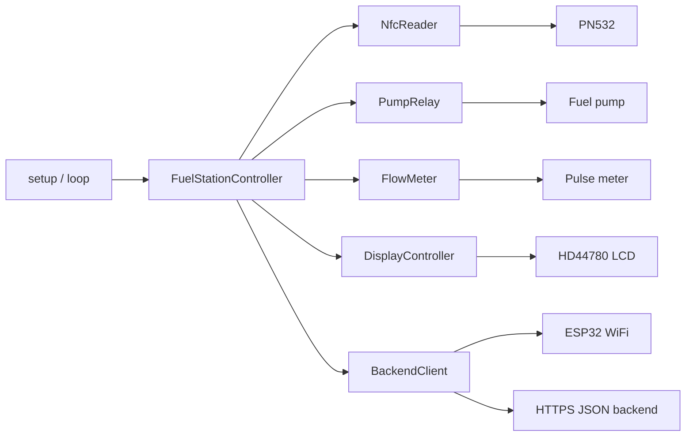
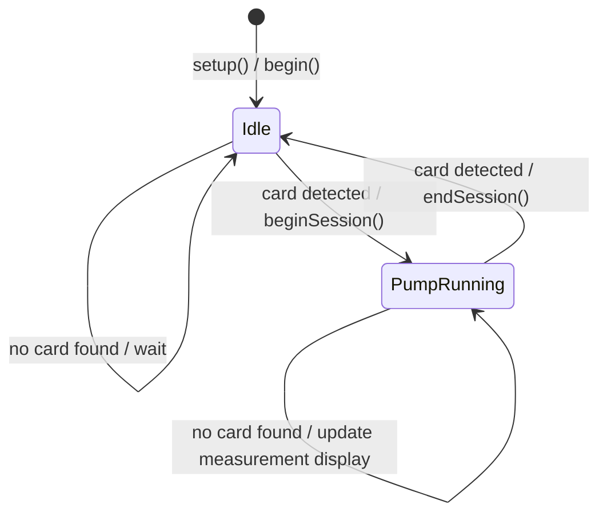
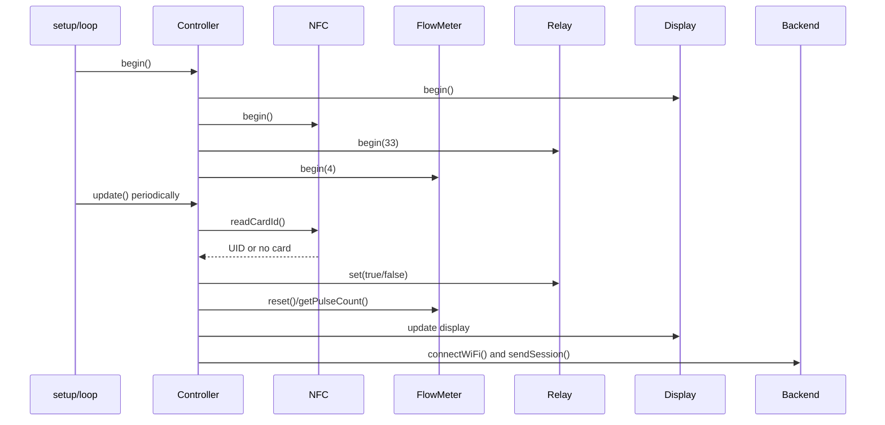

# Fuel Station Terminal - Architecture and State Machine Documentation

## 1. Purpose and System Overview

The firmware controls an ESP32-S3 terminal for a fuel station pump. An NFC card starts or ends a fueling session. While the pump is running, a pulse meter counts the dispensed amount. After the pump stops, the session data is sent to a backend as JSON over HTTPS. If the network or backend is unavailable, the session is stored in the ESP32 LittleFS filesystem and retried later.

The application consists of:

- `FuelStationController` as the central application controller
- `NfcReader` for card detection
- `PumpRelay` for switching the pump
- `FlowMeter` for pulse counting and liter calculation
- `DisplayController` for the 16x2 I2C display
- `BackendClient` for WiFi and HTTPS/JSON communication

The Arduino entry point in `src/main.cpp` calls `FuelStationController::begin()` once and `FuelStationController::update()` in a loop.

## 2. Components and Dependencies



`FuelStationController` owns the device classes and coordinates them. Each device class contains only the control logic for its own hardware or connection.

## 3. Classes

### 3.1 `FuelStationController`

Files: `include/fuel_station_controller.h`, `src/fuel_station_controller.cpp`

The central application class. It owns all subsystems and manages the current station state.

#### Public methods

- `begin()` initializes the display, NFC reader, relay, and flow meter, then sets the state to `Idle`.
- `update()` reads new NFC cards, starts or ends sessions, and updates the measurements and display while pumping.

#### Private methods

- `beginSession(cardUid)` initializes a new session, resets the counter, switches the relay on, and changes the state to `PumpRunning`.
- `endSession(cardUid)` reads the final values, switches the relay off, changes the state to `Idle`, and sends the session to the backend.

#### Owned objects and state

- `display_`: LCD output
- `nfc_`: NFC reader
- `relay_`: pump relay
- `flowMeter_`: pulse meter
- `backend_`: WiFi/HTTPS client
- `state_`: current `StationState`
- `session_`: current `SessionData`

### 3.2 `NfcReader`

Files: `include/nfc_reader.h`, `src/nfc_reader.cpp`

Encapsulates the PN532 over SPI. The pins are taken from `config.h`.

- `begin()` starts the PN532, checks its firmware, and enables card reading.
- `readCardId(cardUid)` waits up to one second for an ISO14443 card. On success, it returns the UID as an uppercase hexadecimal string.

If the PN532 is not found during startup, the method prints an error and remains in an infinite wait loop. The controller cannot continue in that situation.

### 3.3 `PumpRelay`

Files: `include/pump_relay.h`, `src/pump_relay.cpp`

Encapsulates the digital relay output.

- `begin(pin)` configures the pin as an output and switches the pump off.
- `set(enabled)` sets the output to `HIGH` or `LOW` and stores the state internally.
- `isEnabled()` returns the last relay state set by the class.

The current implementation uses active-high logic: `true` maps to `HIGH` and therefore switches the pump on.

### 3.4 `FlowMeter`

Files: `include/flow_meter.h`, `src/flow_meter.cpp`

Encapsulates the pulse input of the flow meter.

- `begin(pin)` configures the input with `INPUT_PULLUP`, resets the counter, and registers an interrupt on the rising edge.
- `reset()` resets the pulse counter while interrupts are disabled.
- `getPulseCount()` returns the number of pulses.
- `getLiters()` calculates `pulseCount * LITERS_PER_PULSE`.

The interrupt callback increments `pulseCount_`. The counter is declared `volatile` because it is accessed both by the interrupt and by normal application code.

Important: `LITERS_PER_PULSE` is currently set to `100.0f`. Therefore, one pulse represents 100 liters. This matches a meter that generates one pulse per 100 liters.

### 3.5 `DisplayController`

Files: `include/display_controller.h`, `src/display_controller.cpp`

Encapsulates the 16x2 LCD over I2C.

- `begin()` initializes the LCD and backlight, displays the boot message, and then shows the ready state.
- `showIdle()` displays `Bereit` and `Karte lesen`.
- `showAccepted(uid)` displays the detected card and at most the first 16 characters of its UID.
- `showPumpRunning(liters)` displays the active pump and the calculated liters.
- `showPumpStopped()` displays that the pump has stopped and data is being sent.

The display is rewritten on every `update()` iteration while the state is `PumpRunning`.

### 3.6 `BackendClient`

Files: `include/backend_client.h`, `src/backend_client.cpp`

Encapsulates the WiFi connection and HTTPS request.

- `connectWiFi()` sets station mode, starts the connection, and waits up to 20 times 500 ms for `WL_CONNECTED`.
- `sendSession(session)` opens a `WiFiClientSecure` connection to port 443 and sends a manual HTTP POST with a JSON payload.
- `begin()` mounts LittleFS and enables the persistent offline queue.
- `queueSession(session)` stores a session as a JSON file under `/offline_*.json`.
- `flushPendingSessions()` sends queued files and deletes each file only after a successful 2xx HTTP response.

The JSON fields are:

```json
{
  "card_uid": "...",
  "pulse_count": 0,
  "liters": 0.0,
  "started_at": 0,
  "ended_at": 0,
  "status": "pump_stopped"
}
```

The TLS client currently uses `setInsecure()`. The connection is encrypted, but the server certificate is not verified. Production deployments should use a root certificate or another certificate validation method.

## 4. Shared Data Models and Configuration

File: `include/config.h`

### Hardware constants

| Function | Constant | Value |
| --- | --- | ---: |
| Relay | `PIN_RELAY` | 33 |
| Flow meter | `PIN_FLOW_METER` | 4 |
| PN532 SCK | `PIN_PN532_SCK` | 36 |
| PN532 MISO | `PIN_PN532_MISO` | 35 |
| PN532 MOSI | `PIN_PN532_MOSI` | 37 |
| PN532 SS | `PIN_PN532_SS` | 7 |
| LCD address | `LCD_ADDRESS` | `0x27` |
| Conversion factor | `LITERS_PER_PULSE` | `100.0` |

### `SessionData`

Stores the data for an active or completed session:

- `cardUid`: UID of the last detected card
- `pulseCount`: final pulse count
- `liters`: calculated quantity
- `startedAt`: `millis()` value at session start
- `endedAt`: `millis()` value at session end

The time values are runtime values since the ESP32 booted, not Unix timestamps.

### `StationState`

Two states are currently defined:

- `Idle`: pump off, terminal waiting for a card.
- `PumpRunning`: pump on, pulses are being measured and the display is updated.

## 5. Overall State Machine



### State `Idle`

1. `NfcReader::readCardId()` is called periodically.
2. Without a card, the state remains unchanged.
3. When a card is detected, the controller calls `beginSession()`.

### Transition `Idle -> PumpRunning`

`beginSession()` performs these steps:

1. Store the card UID in `session_`.
2. Reset pulse and liter values to zero.
3. Store the start time using `millis()`.
4. Call `FlowMeter::reset()`.
5. Switch the relay on.
6. Set the state to `PumpRunning`.
7. Show the acceptance message on the display.
8. Wait 1.2 seconds.

### State `PumpRunning`

On every `update()` iteration:

1. Check for a new NFC card.
2. If no card is detected, read the current pulse count.
3. Calculate the current liters.
4. Call `showPumpRunning()` with the current value.

### Transition `PumpRunning -> Idle`

`endSession()` performs these steps:

1. Update the card UID.
2. Read the final flow-meter count.
3. Calculate the final liters.
4. Store the end time using `millis()`.
5. Switch the relay off.
6. Set the state to `Idle`.
7. Show the stopped message.
8. Wait 1.2 seconds.
9. Connect to WiFi.
10. Send the session over HTTPS.
11. Show the ready screen again.

## 6. Runtime and Error Behavior

- The main loop calls `update()` and then waits 100 ms.
- The NFC query can block for up to 1000 ms.
- The WiFi connection can block for up to 10 seconds.
- The pump is switched off before network access begins. A slow or unavailable backend therefore does not keep the pump running.
- The return value of `connectWiFi()` is currently ignored in `endSession()`. `sendSession()` returns `false` when there is no connection, but the display still returns to `Idle`.
- `sendSession()` does not currently validate the HTTP status code. A successful TCP/TLS connection is effectively treated as a successful send.
- The card detected while stopping is accepted without comparing it to the card used to start the session.
- If the PN532 fails during `begin()`, the system remains stopped in the error loop.
- If WiFi or the backend is unavailable after a fueling session, the completed session is written to LittleFS before the controller returns to `Idle`.
- Pending sessions are retried during startup, after a successful live upload, and periodically every 30 seconds while the station is idle.
- A queued session is deleted only after the backend returns an HTTP 2xx response. Failed uploads remain on the filesystem for a later retry.
- LittleFS is mounted with automatic formatting enabled. If the filesystem cannot be mounted, existing offline data may be lost when it is reformatted.

## 7. Initialization and Data Flow



## 8. Entry Point

File: `src/main.cpp`

- `setup()` starts the serial interface and initializes the global `FuelStationController`.
- `loop()` calls `station.update()` and limits the polling frequency with a 100 ms delay.

The project uses the native Arduino framework in PlatformIO. The framework therefore provides the ESP32 entry point; a custom `app_main()` implementation is not required.

## 9. Configuration Notes

The placeholders in `config.h` must be replaced before testing against a real backend:

- `WIFI_SSID`
- `WIFI_PASSWORD`
- `API_HOST`
- `API_PATH`

The firmware uses Arduino on top of ESP-IDF and can still include ESP-IDF headers and use ESP-IDF APIs when the required components are available and linked by the Arduino framework.
